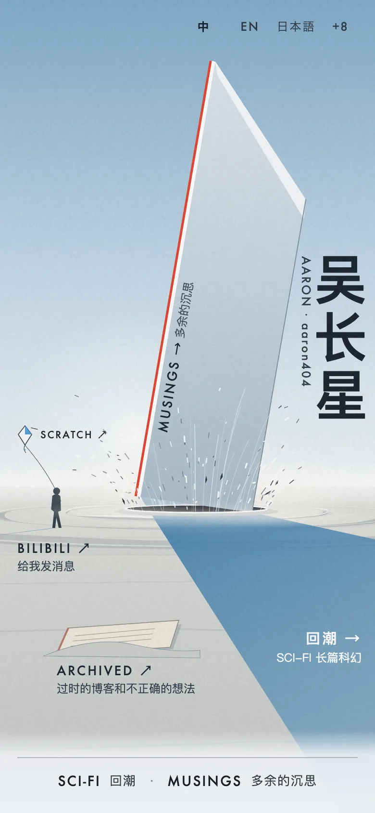
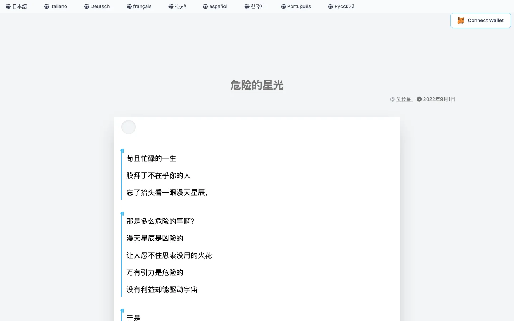
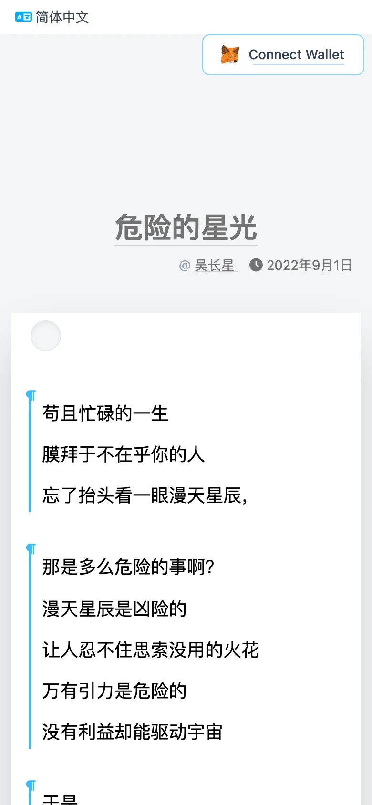
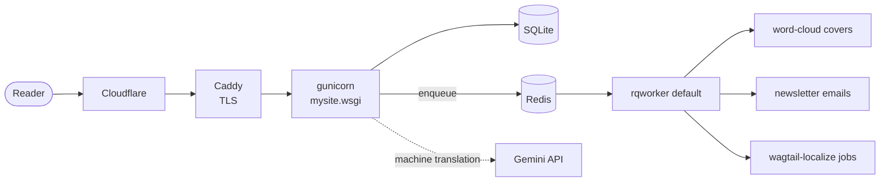

# Macaw

**The source of [aaron404.com](https://aaron404.com): a Chinese-first personal blog on Django and Wagtail, machine-translated into eleven more languages, with a hand-generated SVG poster for a home page and a paper-sheet reading view.**

[](https://github.com/wu-changxing/macaw/actions/workflows/tests.yml)
[](https://github.com/wu-changxing/macaw/actions/workflows/deploy.yml)
[](.python-version)
[](requirements.txt)
[](requirements.txt)
[](LICENSE)
[](https://aaron404.com)

<p align="center">
  <a href="docs/video/macaw.mp4"></a>
  <br>
  <sub>▶ <a href="docs/video/macaw.mp4">Watch the 38-second tour</a> (with sound): the poster, the paper sheet, eleven languages, one-click share images and the repo.</sub>
</p>

<table>
  <tr>
    <td width="76%"><a href="https://aaron404.com"></a></td>
    <td width="24%"><a href="https://aaron404.com"></a></td>
  </tr>
  <tr>
    <td></td>
    <td></td>
  </tr>
</table>

<sub>Screenshots of the live site, 1440×900 and 390×844. The design is explained in [docs/design.md](docs/design.md).</sub>

## Features

**Writing**
- Two page types: `BlogPage` (one rich-text body) and the "Engineering page" `flex.Engineer`, a StreamField with paragraphs, quotes, poems, cards, call-to-action blocks, buttons, code blocks with syntax highlighting, and LaTeX math.
- Several authors per post (author snippets), and extra editor features: highlight (`<mark>`), inline code, centred text.
- Optional word-cloud cover, built in the background from the post's keywords (jieba + wordcloud; the CJK fonts are in the repo).

**Multilingual**
- Locales: zh-hans (source), zh-hant, en, ja, ko, fr, de, es, it, pt, ru, ar.
- Machine translation through `wagtail-localize` with a Gemini backend, `GPTPlugins.models.GeminiTranslator`.
- A locale copy that still has the Chinese title counts as untranslated: it is `noindex`, canonicalises to the Chinese page, and is left out of the sitemap and hreflang.
- `python manage.py translate_pages` backfills every live source page into the other locales and publishes the result without sending newsletters. Pages that are already translated are skipped; `--dry-run` prints the pending string and character counts.

**Readers**
- Email subscriptions with double opt-in at `/subscribe/new/`, one-click unsubscribe links and `List-Unsubscribe` headers. Tick "notify subscribers" on a post and confirmed subscribers are emailed in the background when it is published.
- Sign-to-comment: readers sign a comment with an Ethereum wallet (`personal_sign`, so no gas). The server recovers the signer, rejects stale, replayed or mismatched signatures, and rate-limits by IP and by wallet. Comments can be hidden in Django admin. See [the security model](docs/architecture.md#sign-to-comment-security-model).
- Site search at `/search/`.

**SEO and discovery**
- Per page: meta description, canonical URL, hreflang links to every real translation, Open Graph and Twitter tags, JSON-LD (`BlogPosting`, `BreadcrumbList`, `WebSite`).
- `/sitemap.xml` across all locales, `/robots.txt`, `/feed/` (RSS), and `/llms.txt` plus `/llms-full.txt` for AI search engines.
- Wagtail API v2 at `/api/v2/pages/`.

## Quick start

You need Python 3.14. Five commands give you a running site, starting from Wagtail's welcome page:

```bash
git clone https://github.com/wu-changxing/macaw.git && cd macaw
python3.14 -m venv venv && source venv/bin/activate
pip install -r requirements.txt
python manage.py migrate
python manage.py runserver        # http://localhost:8000
```

Then `python manage.py createsuperuser` and sign in at http://localhost:8000/admin/. To get the poster home page, create a Homepage Item snippet or two (items named `Archived`, `Bilibili` and `Scratch` become doors), add an "index page" (`HomePage`) under Root, point the site at it in Settings → Sites, and give it child sections (`BlogIndexPage`) with posts. `manage.py` uses `mysite.settings.dev` (`DEBUG = True`, emails printed to the console).

Redis is only needed for background jobs (covers, newsletters, wagtail-localize jobs). Browsing, writing and the tests work without it:

```bash
redis-server
python manage.py rqworker default
```

Run the tests with `python manage.py test`. The compiled `mysite/static/css/main.css` is committed; rebuild it only when you change the classes used in templates (`cd tailwind && npm install && npm run build`).

## Architecture



- Pages are rendered on the server with Django templates and a compiled Tailwind stylesheet. There is no Node at runtime.
- Anything slow is a `django_rq` job, so saving a page returns at once.
- The default language (zh-hans) has no URL prefix; other locales are served under `/<lang>/`.

The full picture (request path, page types, translation flow, jobs, the SEO/GEO layer and the comment security model) is in **[docs/architecture.md](docs/architecture.md)**. The visual design (the paper sheet and the generated Blade poster) is in **[docs/design.md](docs/design.md)**.

<details>
<summary>URL map</summary>

| Path | What |
|------|------|
| `/admin/` | Wagtail admin (writing, translating, subscribers) |
| `/django-admin/` | Django admin (comment moderation) |
| `/django-rq/` | RQ queue dashboard (staff only) |
| `/api/v2/pages/` | Wagtail API |
| `/comments/` | Sign-to-comment endpoint (POST) |
| `/sitemap.xml`, `/robots.txt`, `/feed/`, `/llms.txt`, `/llms-full.txt` | Discovery |
| `/healthz` | Database and Redis check, used by the deploy |
| `/subscribe/new/` | Subscription form |
| `/search/` | Search |
| everything else | Wagtail page tree |

</details>

## Multilingual and machine translation

1. Posts are written in Simplified Chinese, the source locale.
2. In the admin, an editor creates a translation of a page with `wagtail-localize` and presses machine translate.
3. `GeminiTranslator` packs the page's text segments into chunks of about 6000 characters (a segment is never split), sends up to five chunks in parallel, and asks Gemini for a JSON array of `{id, text}` objects under a response schema.
4. The answer is rejected unless every segment comes back once, in order, non-empty and untruncated. Nothing is merged from a partial answer.
5. Until a translation's title differs from the Chinese title, the page stays out of search engines (see above).

Details and failure modes: [docs/architecture.md#translation-flow](docs/architecture.md#translation-flow).

### Backfill translations

Run with the production environment and Gemini API key configured:

```bash
python manage.py translate_pages --locale en --limit 3 --dry-run
python manage.py translate_pages --locale en --limit 3
python manage.py translate_pages --dry-run
python manage.py translate_pages
```

`--locale` and `--page ID` can be repeated. `--limit N` counts source pages per locale,
including skipped pages, in tree order (home and sections before posts). `--no-publish`
saves drafts, preserving an existing translation's published content; synced aliases
become unpublished drafts. When `--page` selects a child whose translated parents are missing,
Localize creates source-language parent aliases; run the whole tree to translate them too.
Dry runs make no writes or API calls and print only page IDs, locale codes, pending
string/character counts and planned statuses. Counts deduplicate equal strings within
each page/locale; characters measure source HTML sent to the translator, excluding
prompt overhead. API errors stop the command and roll back that page/locale; earlier
completed pages remain saved. Re-run after fixing the error.

## Configuration

Configuration lives in `.env` (loaded by python-dotenv, never committed). Copy [`.env.example`](.env.example); every value is optional for local work.

| Variable | Used for |
|----------|----------|
| `SECRET_KEY` | Django secret key. Required by `mysite.settings.production` only. |
| `GEMINI_API_KEY` | Gemini machine translation. Without it the translator reports it can't translate. |
| `GEMINI_MODEL` | Optional model override (default `gemini-3.8-flash`) |
| `EMAIL_HOST`, `EMAIL_HOST_USER`, `EMAIL_HOST_PASSWORD`, `DEFAULT_FROM_EMAIL` | SMTP for subscriber emails |
| `EMAIL_BACKEND` | Overrides the Django email backend |

Settings: `mysite/settings/base.py` (shared: apps, locales, RQ, email), `dev.py` (local), `production.py` (`DEBUG = False`, HTTPS behind the proxy, HSTS, secure cookies, CORS limited to `/api/`). Select production with `DJANGO_SETTINGS_MODULE=mysite.settings.production`.

## Deployment

Every push to `main` deploys through [`.github/workflows/deploy.yml`](.github/workflows/deploy.yml), which fetches `origin/main` on the server over SSH and runs [`scripts/deploy.sh`](scripts/deploy.sh):

1. Take an online SQLite backup, then reset to `origin/main`.
2. If `.python-version` changed, build a new virtualenv and keep the old one as `venv.prev`.
3. Stop the services, run `migrate` and `collectstatic` with production settings.
4. Restart `blog` (gunicorn, configured by [`gunicorn.conf.py`](gunicorn.conf.py)) and `blog-worker` (RQ), then check both services, `/healthz` and a real article.
5. On any failure, restore the previous code, database and virtualenv.

The workflow reads three repository secrets: `SERVER_HOST`, `SERVER_USER` and `SERVER_SSH_KEY`. Because `main` is production, all work goes through a branch and a pull request, and [`tests.yml`](.github/workflows/tests.yml) runs the suite on every push and PR.

## Project layout

```
blog/          BlogPage, BlogIndexPage, authors, rich-text hooks; tasks/ = cover + email jobs
flex/          "Engineering page" (StreamField + code blocks + math)
streams/       StreamField block definitions used by flex
home/          HomePage, door snippets; blade/gen.py generates the home poster
subscribe/     Subscriber model, double opt-in, admin listing
comments/      Wallet sign-to-comment
seo/           Head tags, sitemap, robots.txt, RSS, llms.txt, /healthz
search/        Search view
GPTPlugins/    Gemini translator and management/commands/translate_pages.py backfill
mysite/        Settings, URLs, API router, templates, static files
tailwind/      Tailwind 3 config that compiles mysite/static/css/main.css
frontend/      Source of the older React wallet widget (bundle in mysite/static/js)
scripts/       deploy.sh and a Selenium helper for batch translation
docs/          Architecture and design write-ups, README images
- `python manage.py translate_pages` backfills every live source page into the other locales and publishes the result without sending newsletters. Pages that are already translated are skipped; `--dry-run` prints the pending string and character counts.
```

## Contributing

Issues and pull requests are welcome. Read [CONTRIBUTING.md](CONTRIBUTING.md) first: it covers setup, tests, code conventions, and why changes to the reading design need before/after screenshots. Please report security problems privately, as described in [SECURITY.md](SECURITY.md). Everyone taking part is expected to follow the [Code of Conduct](CODE_OF_CONDUCT.md).

## License

[MIT](LICENSE) © 2022-2026 Changxing Wu
