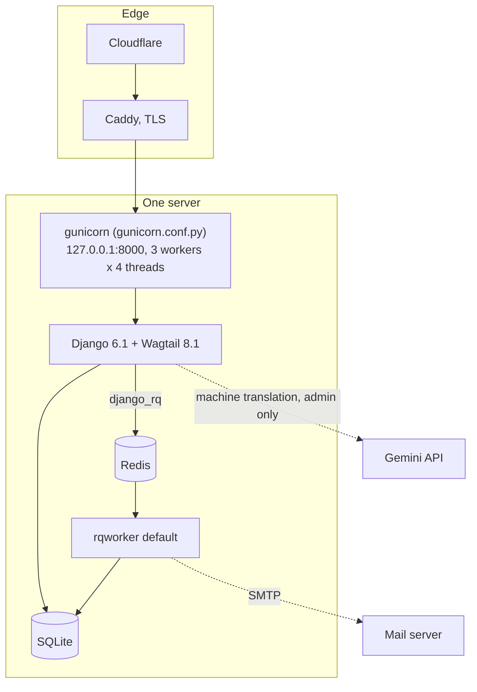
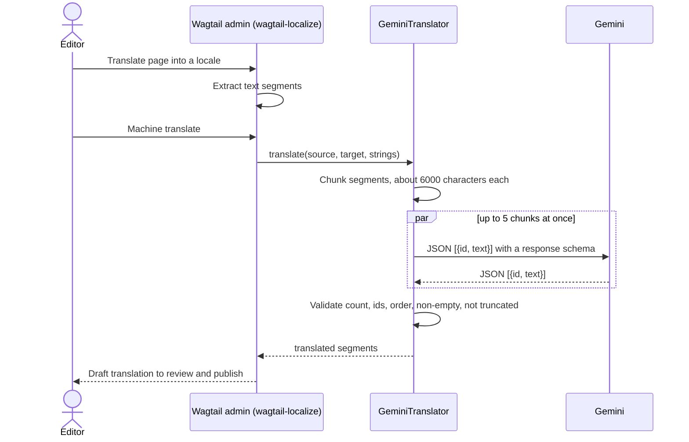

# Architecture

How aaron404.com is put together: the path a request takes, the page types, how a Chinese post becomes eleven translations, what runs in the background, the SEO/GEO layer, and how comments are secured without accounts.

Every statement here is about code in this repository; file paths are given so you can check.

## Contents

- [Components](#components)
- [Request path](#request-path)
- [Page types](#page-types)
- [Translation flow](#translation-flow)
- [Background jobs](#background-jobs)
- [SEO and GEO layer](#seo-and-geo-layer)
- [Sign-to-comment security model](#sign-to-comment-security-model)
- [Other abuse controls](#other-abuse-controls)

## Components



One process type serves pages, one consumes jobs. Both are systemd services on the same machine (`blog` and `blog-worker`) and share the SQLite file. There is no Node at runtime: Tailwind is compiled ahead of time into `mysite/static/css/main.css`.

## Request path

1. **Cloudflare, then Caddy.** Caddy terminates TLS and sets `X-Forwarded-Proto`. `mysite/settings/production.py` trusts that header (`SECURE_PROXY_SSL_HEADER`) and turns on HTTPS redirects, HSTS and secure cookies.
2. **gunicorn** binds to loopback only, with `gthread` workers, a 60 s timeout and request-size limits (`gunicorn.conf.py`). Production is WSGI; the ASGI entry point is a leftover and is not used.
3. **Middleware** (`mysite/settings/base.py`): sessions, CORS (limited to `^/api/` in production, with no allowed origins), CSRF, clickjacking protection, security headers, `LocaleMiddleware`, Wagtail redirects, and `django-axes` for login lockout.
4. **Routing** (`mysite/urls.py`) has two halves:
   - Language-neutral: `/api/v2/`, `/django-rq/`, `/comments/`, the discovery endpoints from `seo/urls.py` (`/robots.txt`, `/sitemap.xml`, `/feed/`, `/llms.txt`, `/llms-full.txt`, `/healthz`, `/favicon.ico`), `/admin/`, `/django-admin/`, `/documents/`.
   - `i18n_patterns(..., prefix_default_language=False)`: `/subscribe/`, `/search/` and the Wagtail page tree. Chinese pages live at `/…`; other locales at `/<lang>/…`.
5. **Wagtail** resolves the page and calls its `get_context` and template. Crawler endpoints that render every post are wrapped in `cache_page(60 * 60)`.

`/healthz` runs `SELECT 1` against SQLite and pings Redis; the deploy script refuses to finish unless it answers `ok`.

## Page types

| Model | Where | What it is |
|-------|-------|------------|
| `HomePage` | `home/models.py` | The Blade poster. Finds its sections (children of the default-locale home), the two main doors by slug (`musings`, `blog`), and the external doors from `HomeItem` snippets by name. |
| `BlogIndexPage` | `blog/models.py` | A section: an intro and a list of its live, public children with covers. |
| `BlogPage` | `blog/models.py` | An article with one rich-text body, a date, authors, an optional generated cover and a "notify subscribers" flag. |
| `Engineer` | `flex/models.py` | The "Engineering page": the same metadata with a StreamField body (`streams/blocks.py`): code, math, quotes, poems, cards, CTAs, buttons. |

Snippets: `HomeItem` (home page doors), `BlogAuthor` and `flex.Author` (authors). Both article types render a share page with `?type=share` (`share_base.html`, filled by `blog_share.html` / `tech_share.html`), which the paperclip button on an article opens. It turns the article into images in the browser (`static/js/share.js`, dom-to-image at 2x): a long image of the whole article, a 3:4 cover, or up to nine 3:4 slides.

The API (`mysite/api.py`) exposes only the `pages` endpoint. Image and document listings were removed because they enumerated uploads attached to drafts.

## Translation flow



- **Source and targets.** `LANGUAGE_CODE = "zh-hans"`; `WAGTAIL_CONTENT_LANGUAGES` lists 12 locales. wagtail-localize keeps one page tree per locale, linked by `translation_key`.
- **Backend.** `WAGTAILLOCALIZE_MACHINE_TRANSLATOR` points at `GPTPlugins.models.GeminiTranslator`. `can_translate` is false when `GEMINI_API_KEY` is unset, so the button simply isn't offered.
- **Chunking** (`get_chunked_strings`). Segments are packed into chunks of about 6000 characters. A segment is never split; one larger than the budget gets a chunk of its own.
- **The call** (`GPTPlugins/gpt_request_handler.py`). Each chunk is sent as a JSON array of `{id, text}`. The system prompt tells the model to treat the text as data, never as instructions, and to keep HTML tags. `response_mime_type` is JSON with a response schema; temperature is 0.3. The model is `GEMINI_MODEL`, default `gemini-3.8-flash`.
- **Validation** (`validate_translation`). A response is rejected if it is empty, truncated (`MAX_TOKENS`), the wrong length, has ids that aren't `0..n-1` in order, or has an empty segment. Any failure raises, so a page is never half-translated with misaligned text.
- **Where it runs.** Machine translation runs inside the admin request. wagtail-localize's own background work (translating a whole subtree, syncing trees) goes to the RQ queue through `WAGTAILLOCALIZE_JOBS`.
- **Untranslated copies.** wagtail-localize creates a locale copy before anything is translated, holding the Chinese text. `seo_tags.untranslated_source` treats a copy whose title equals the Chinese title as untranslated. Such a page gets `noindex,follow`, a canonical URL pointing at the Chinese page, and is left out of the sitemap, the hreflang set and `llms.txt`.

`python manage.py translate_pages` translates every live source page into the other locales in bulk and publishes the result without sending newsletters (`--dry-run`, `--locale`, `--limit`, `--page`, `--no-publish`).

## Background jobs

Jobs are `django_rq` functions on the `default` queue (`RQ_QUEUES` in `base.py`), consumed by `python manage.py rqworker default`.

| Job | Trigger | What it does |
|-----|---------|--------------|
| `blog.tasks.tasks.generate_keywords_and_image` | Saving a `BlogPage` or `Engineer` with "generate cover" ticked | The admin form names the file (`covers/<uuid>.png`) and sets `cover_image` straight away, then the job strips the markup, extracts keywords with jieba (custom stop words) and draws a word cloud with the bundled Source Han Serif font. |
| `blog.tasks.send_email.send_emails` | Publishing a page whose "notify subscribers" flag is set | Emails every **confirmed** subscriber, each with a personal unsubscribe link and `List-Unsubscribe` / `List-Unsubscribe-Post` headers (RFC 8058). |
| wagtail-localize jobs | Translating a subtree, syncing trees | See above. |

The newsletter is driven by the `page_published` signal (`blog.models.notify_on_publish`), not by saving, so a draft never mails anyone. The handler clears the flag on the page and on the published revision first, so re-publishing never mails twice; it skips private pages; and it enqueues only `on_commit`, so the job never reads a half-written transaction.

## SEO and GEO layer

All of it lives in `seo/`. "GEO" here means generative-engine optimisation: making the site easy for AI search engines to read and cite.

**In every page's `<head>`** (`seo/templatetags/seo_tags.py`, `seo/templates/seo/head.html`):

- Meta description, from `search_description` or the start of the body.
- A canonical URL, always HTTPS. An untranslated copy points at its Chinese source.
- `hreflang` alternates for every real translation, plus `x-default`.
- Open Graph and Twitter Card tags, with `og:locale:alternate` for each translation and the cover as `og:image`.
- JSON-LD: `BlogPosting` (with section, word count that counts CJK characters one by one, dates and author) and `BreadcrumbList` on articles; `WebSite` with its sections as `CollectionPage`s on the home page; `ProfilePage` on the author page.

**Crawler endpoints** (`seo/views.py`):

| Path | Content |
|------|---------|
| `/robots.txt` | Disallows `/admin/`, `/django-admin/`, `/django-rq/`, `/search/`, `/api/`; points at the sitemap. |
| `/sitemap.xml` | Every routable page in every locale, minus untranslated copies, with hreflang alternates, `lastmod` and cover image. |
| `/feed/` | RSS of the latest 30 Chinese posts. |
| `/llms.txt` | A site summary for language models: author line, sections with their posts and one-line descriptions, and the English translations. |
| `/llms-full.txt` | The plain text of every Chinese post. |

The expensive ones are cached for an hour.

## Sign-to-comment security model

Readers comment without accounts or passwords. Instead they prove control of an Ethereum address by signing the comment. The code is `comments/views.py`.

**What gets signed.** The comment form receives the server's message template (`comments/templatetags/comment_tags.py`); `comments.js` fills it in and asks the wallet to `personal_sign` it (EIP-191, free, no transaction):

```
Sign to post this comment on aaron404.com

Page: <page_id>
Issued at: <ISO timestamp>

<comment body>
```

Binding the site name, page id, time and body into the signature means a signature can't be moved to another site, page, time or text.

**What the server checks, cheapest first** (`post_comment`, one database transaction):

1. **Shape.** JSON object; `body`, `address`, `signature`, `issued_at` are strings; `page_id` is an integer.
2. **Load.** At most 60 comments an hour site-wide and 5 per client IP. Wallets cost nothing to create, so the IP cap comes before any crypto. The IP comes from `CF-Connecting-IP`, then `X-Forwarded-For`, then the socket; IPv6 clients are grouped by their /64 so one host can't rotate through its own addresses.
3. **Body.** 1 to 2000 characters after trimming.
4. **Freshness.** `issued_at` must carry a timezone and be within 10 minutes of the server clock.
5. **Target.** The page must be a live, public `BlogPage` or `Engineer`.
6. **Signature.** The server rebuilds the message from the request, recovers the signer with `eth-account`, and requires it to equal the claimed address (case-insensitively).
7. **Replay.** `intent = sha256(signer + "\n" + message)` is stored with a unique constraint. The same signed comment can't be posted twice, whatever encoding the signature was sent in.
8. **Per-wallet cap.** At most 5 comments an hour per address.

**What it does not do.** A valid signature proves the author controls the address, nothing more: it is not identity and it is not spam-proof. Comments are visible when created; the owner hides them in Django admin (`is_visible`, editable in the list). The page shows the latest 50 visible comments, with shortened addresses.

## Other abuse controls

- **Admin logins** are protected by `django-axes`: 5 failures lock the username+IP pair for an hour, using the same proxy-aware `client_ip`.
- **Subscriptions** use double opt-in (`subscribe/views.py`). The form gives the same answer for new, pending and confirmed addresses, so it can't be used to find out who subscribes. Unconfirmed sign-ups are capped at 5 per IP and 30 in total per hour, and a confirmation email is resent at most every 10 minutes. Confirm and unsubscribe links carry a 32-byte random token.
- **Secrets** are read from the environment (`.env`, never committed); production refuses to start without `SECRET_KEY`.
