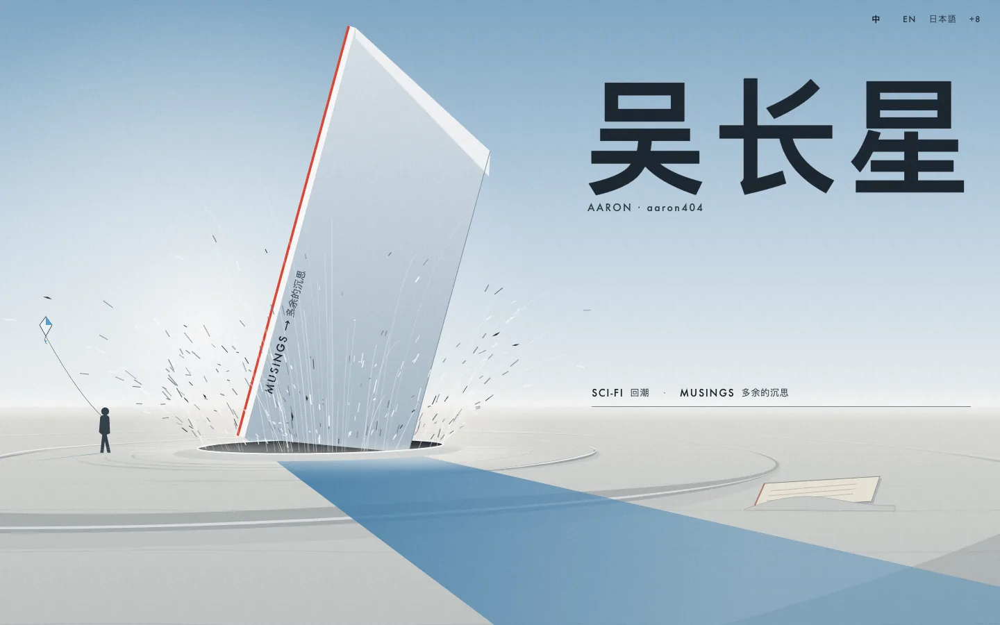
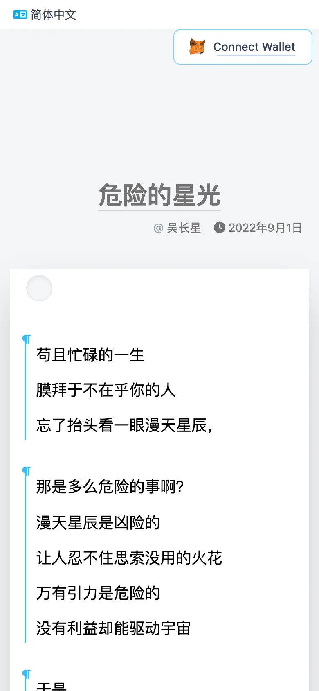

# Design

aaron404.com has two visual ideas. Reading happens on **a sheet of paper**. Arriving happens at **the Blade**, a poster that is also the site's navigation. This document explains both, and how the poster is made.

<p>
  
  
</p>

## Contents

- [Principles](#principles)
- [The paper sheet](#the-paper-sheet)
- [The Blade](#the-blade)
  - [What is in the picture](#what-is-in-the-picture)
  - [How it is generated](#how-it-is-generated)
  - [Why SVG](#why-svg)
  - [Desktop and phone](#desktop-and-phone)
  - [Motion](#motion)
  - [Reduced motion and no JavaScript](#reduced-motion-and-no-javascript)
  - [The section threshold rule](#the-section-threshold-rule)
- [Palette and type](#palette-and-type)
- [Changing the design](#changing-the-design)

## Principles

- **The text is the product.** Article pages have no sidebar, no related-posts grid and no header bar competing with the words.
- **One picture, many doors.** The home page is a single composition. Every link on it is an object in the scene.
- **Still first, motion second.** Each page is complete as a still image. Motion is added on top and can always be skipped or switched off.
- **Generated, not drawn by hand.** The poster is the output of a small program, so it can be changed by editing numbers and re-running it.

## The paper sheet

Every article (`mysite/templates/blog/blog_page.html`, `flex/tech.html`) sits on a white sheet that floats over a light grey page (`bg-gray-100` in `blog_base.html`). The sheet is a single `div` with Tailwind's `shadow-2xl bg-white`: one large, soft drop shadow and no border, so it reads as paper lifted off a desk rather than a card in a grid.

| Element | How it is built | Why |
|---------|-----------------|-----|
| Title | Large, grey (`text-neutral-500`), with a thin grey underline offset below it that turns sky blue (`basicBlue`) on hover | The title is a label, not a headline; the text below it carries the weight. |
| Margins | `mx-5 sm:mx-4 md:mx-20 lg:mx-40 xl:mx-80`, inner padding up to `xl:px-32` | The sheet narrows on wide screens so lines stay a readable length. |
| Body | `text-2xl leading-loose`, paragraphs spaced with `space-y-5` | Chinese prose at a generous size and line height. |
| Back button | A small grey circle with an inner shadow at the top-left corner of the sheet, linking to the section | Like a punched hole in the paper; no word "back" needed. |
| Page turns | `<` and `>` links to the previous and next article at the foot of the sheet | The number of arrows grows with how many articles lie in that direction (`BlogPage.get_context`), so the arrows double as a "where am I in this series" gauge. |
| Paperclip | Opens the same article in its compact share layout (`?type=share`) | Clipping the page to send it on. |

`mysite/static/css/paper-polish.css` is loaded after the compiled Tailwind file and changes nothing about how a desktop page looks at rest. It adds press feedback (the back circle sinks, links nudge down), visible focus rings, larger touch targets for the one-character arrows, and on phones (under 640 px) it trades the 24 px body text for 19 px with a 1.85 line height, which roughly doubles the characters per line.

## The Blade

The home page (`home/models.py`, `mysite/templates/home/home_page.html`) is a poster titled 刃, "the Blade": a steel blade has just been driven into pale sand. The impact is frozen about 140 ms after it hit.

### What is in the picture

Each object is a link (a "door"), drawn as an SVG `<a>` with its own hit area, focus ring and caption:

| Object | Leads to | Where the link comes from |
|--------|----------|---------------------------|
| The blade | 多余的沉思 Musings | the home's child section with slug `musings` (`BLADE_SLUG`) |
| The blade's long blue shadow | 回潮, a long-form science-fiction serial | the section with slug `blog` (`SHADOW_SLUG`) |
| A sheet half-buried in the sand | The archived old blog | the `HomeItem` snippet named `Archived` |
| A small figure standing on the horizon | Bilibili | the `HomeItem` named `Bilibili` |
| A kite held by the figure | Scratch projects | the `HomeItem` named `Scratch` |

The author's name, 吴长星, is set large on the right as type in the sky. A line of section names (the "credit line") stands on the horizon. Captions appear on hover and focus; on touch screens (`hover: none`) they are always shown, so one tap navigates.

### How it is generated

`home/blade/gen.py` is a standard-library-only Python script. Run it from anywhere:

```bash
python home/blade/gen.py
```

It writes two files, both committed:

- `mysite/templates/home/blade_scene.html`: two inline SVG compositions, one for desktop (1440×900) and one for phones (390×844). It is a Django template: every `href` is a template variable (`{{ blade_page.url }}`, `{{ doors.Archived.link }}`, …), so the picture never hard-codes a URL. A header comment says "edit the generator, not this file".
- `home/static/home/grain.png`: a 96×96 grey noise tile laid over the whole poster at 7% opacity, written as a minimal 8-bit PNG by hand (`zlib` + `struct`).

The two compositions come from two dictionaries, `DESK` and `PHONE`, which hold every placement: the horizon height `HZ`, focal length `f`, the blade's tip and base corners, the sun position for the shadow, the crater radius, the pressure waves, particle counts, and where the figure, kite, buried sheet and name go. `build()` runs the same sequence of painters over either one, back to front: sky, ground, waves, shadow, buried sheet, figure, kite, rays, dust, crater, ejecta behind the blade, light streaks, the blade, the crater's near rim, ejecta in front, dust in front, the name, and a white flash frame used by the intro.

**Perspective.** The ground is a real perspective plane. With the camera one unit above the sand, a ground point `(X, Z)` at height `Y` projects to `(cx + f·X/Z, HZ + f·(1−Y)/Z)` (`Scene.P`). Everything on the sand (wind ridges, the crater, the three pressure waves, the ejected grains) is built in that space, so it foreshortens and thins with distance the way real things do. The figure's head is placed exactly on the horizon line, which is what an eye-level camera would see.

**Physics, loosely.** The ejecta are ballistic: each grain leaves the crater lip at 50 to 76 degrees with a random speed and is drawn where it would be a fraction of a second later under gravity (`ejecta`). Grains thrown toward the viewer are drawn in front of the blade, the rest behind it. The long axis of the blade throws more sand sideways than forward. Pressure-wave crests are modulated by two sine waves so they break up into a ridge instead of reading as drawn ellipses.

**Deterministic output.** Every random choice uses a seeded `random.Random(n)`, so running the generator twice gives byte-identical files and a change to the picture shows up as a reviewable diff.

**Small output.** Paths are written in relative coordinates with the shortest one-decimal number form (`.5`, `-.5`, `3`), which roughly halves their size. The whole template is about 170 KB, around 40 KB gzipped, with no image requests besides the grain tile.

### Why SVG

- **Sharp at any size and density.** One vector file looks right on a 1x office monitor and a 3x phone, with no image set to maintain.
- **Links are part of the picture.** The doors are real `<a>` elements with `aria-label`s, keyboard focus and their own focus outlines drawn around the shape. A bitmap with an image map can't do that well.
- **It is a template.** URLs, and in future anything else, are filled in by Django at request time.
- **Every layer can move.** The blade, its shadow, each pressure wave, the dust and the two ejecta groups are separate `<g>` elements, so CSS and the Web Animations API can move them independently.
- **It is code.** The picture lives in Git as a program and its output, so it can be reviewed, diffed and regenerated.

### Desktop and phone

The two compositions are separate drawings, not one drawing scaled. The phone version stands the name vertically on the right and moves the captions and the credit line to fit a tall screen. CSS shows one or the other (`blade.css`: `max-width: 640px` or an aspect ratio of 3:4 or narrower selects the phone).

Both are fitted with `preserveAspectRatio="… slice"`, so they always fill the window. The desktop one is anchored right (`xMaxYMid`): on a screen narrower than 16:10 the left edge (figure and kite) is cropped, never the name. The HTML credit line is positioned in scene units (`--u`, computed from container query units to match the SVG's slice scale), so its rule sits exactly on the drawn horizon at any window size.

### Motion

All motion is in `home/static/home/blade.js` and uses the Web Animations API.

- **The intro, once per session** (`sessionStorage`). About 1.5 seconds, written as a beat sheet: a hold; the shadow arrives first; the blade falls in 80 ms along its own axis and overshoots; a single-frame ink flash shows the blade as a solid silhouette; the scene shakes and punches in by 4.5%; the pressure waves expand one after another; the crater and the ejecta crown appear; the dust settles; the doors pulse once; the section line draws itself and its names fade up; a glint runs down the blade's red edge. Any pointer, key, wheel or touch input finishes the intro at once.
- **Afterwards.** The shadow drifts by one degree over a minute, back and forth, paused while the tab is hidden. With a mouse on a desktop-sized screen the scene has a small parallax (at most 8 px), frozen while the pointer is over a door so targets don't slide away from it. Hovering the blade runs the glint again.
- **The blade becomes a page.** Clicking the blade doesn't cut straight to the next page. The other doors fade, the blade stands upright and lifts, and a white sheet with a soft blue shadow grows out of it until it fills the reading column (up to 720 px wide). The blade's red edge turns blue as it lands, and after 900 ms the browser follows the link. The home page hands you the paper you are about to read on. Modifier clicks (new tab, new window) skip the animation, and coming back with the Back button restores the poster from the browser cache instead of a blank sheet.

### Reduced motion and no JavaScript

The markup is the final frame. Every animated layer's resting state is its end state, and anything that only exists during the intro (the flash, the glint, the streaks, the door pulses) is hidden by CSS until script shows it. So:

- **Without JavaScript** the page is the finished still, and every door is an ordinary link.
- **With `prefers-reduced-motion: reduce`** the script returns before doing anything: no intro, no drift, no parallax, no glint, no blade-to-sheet transition (the blade is a plain link). `blade.css` also removes the hover transitions. Captions, focus rings and hover states still work, because they change visibility, not position.

The README screenshots were taken with reduced motion on, which is why they show the final still.

### The section threshold rule

The credit line on the horizon lists the home page's sections, but only the substantial ones. `home/models.py`:

```python
SECTION_MIN_PAGES = 20   # a section is listed on the home page once it holds this many live pages

def is_substantial(section):
    """thin sections (a handful of posts) stay off the home page"""
    return section.get_descendants().live().count() >= SECTION_MIN_PAGES
```

A new section with three posts doesn't get to share the horizon with a body of work that has a hundred. It is still reachable by URL, by search and from the sitemap; it simply joins the poster once it has 20 live pages. The rule is counted on the default-locale (Chinese) tree, so every translated home page shows the same set of sections, linked to their translations where they exist and labelled with the source title plus the Chinese door name. The two main doors, the blade and its shadow, are found by slug and are not subject to the threshold.

## Palette and type

| Role | Value | Used for |
|------|-------|----------|
| Ink | `#16202a` | The name, captions, the blade's silhouette in the flash frame |
| Blade red | `#E2412F` | The blade's cutting edge, the sheet's edge during the transition |
| Sky blue | `#4FA3D8` | Focus rings, link underlines and the kite on the poster |
| Shadow blue | `#3F7DAB` to `#5C96C0` | The blade's shadow |
| Reading blue | `#00a8ff` (`basicBlue` in `tailwind/tailwind.config.js`) | Hover underlines and icons on article pages, the sheet hairline, the subscribe field, and the sky of the share images |
| Sand and sky | `#E2E2DD`, `#C2D7E7`, `#7FA9C8` | Ground and sky gradients |

Latin type on the poster uses Futura where it is installed (falling back through Century Gothic, Avenir Next and Trebuchet MS), letter-spaced and upper-case, like film credits. Chinese uses the system sans (PingFang SC, Hiragino Sans GB, Microsoft YaHei, Noto Sans CJK SC). The poster downloads no web fonts.

## Changing the design

The reading design is deliberate and has been tuned by hand: the shadows, the sky-blue theme colour and the spacing. Changes to templates, CSS, the Tailwind config or the page-turn behaviour need before/after screenshots of the home page, an article and a section index at desktop and phone widths, and the author's sign-off. See [CONTRIBUTING.md](../CONTRIBUTING.md#changing-how-the-site-looks).

To change the poster, edit `home/blade/gen.py`, run it, and commit both the generator and its output. Don't edit `blade_scene.html` by hand: the next run would overwrite it.
